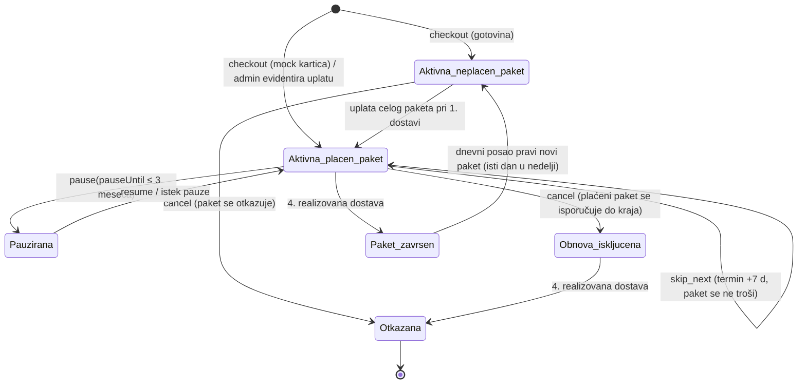

# TEST_PLAN — Mleko i Mleko (Faza 1)

Stanje: 20. 11. 2026, grana `claude/mleko-site-final-changes-15418c` (= `main`). Ovo je plan; testovi iz Faze 2 se pišu tek posle potvrde.

## 1. Popunjen kontekst

| Stavka | Vrednost (iz koda i podešavanja) |
| --- | --- |
| Gradovi | Beograd i Novi Sad (ugrađeni); dodatni gradovi samo ako ih vlasnik doda u adminu (`serviceRegions`) |
| Plaćanje | Gotovina pri dostavi ili uplata na račun. Kartice nisu povezane (nema bankarskog adaptera); postoji samo lokalni `mock` za kartice i webhook |
| Dani dostave | Beograd utorak i petak, Novi Sad petak; tura počinje u 07:00 (Europe/Belgrade) |
| Cutoff | 36 h pre početka ture (`cutoffHours`=36): za utorak nedelja 19:00, za petak sreda 19:00 |
| Proizvod | Samo kravlje mleko 1 l (kozje je van prodaje). Jednokratno 350 RSD/l, pretplata 250 RSD/l, dostava 350 RSD po dostavi, minimum 2 l (`minimumLitres`), maksimum 100 po stavci |
| Pretplata | Paket od 4 nedeljne dostave plaćen unapred; jedini ritam je nedeljni (dvonedeljni se odbija, stari paketi dotrajavaju) |
| Test okruženje | Lokalno: in-memory SQLite po testu (`tests/sqlite-d1.mjs`), Playwright na zasebnoj SQLite bazi; mock plaćanje, mock fiskalizacija, email u `console` režimu |

**Bezbednost okruženja:** `.env.local` u glavnom folderu projekta pokazuje na produkcionu bazu (Supabase) i pravi Fiscomm ključ. Testovi ga ne učitavaju: `npm test` koristi bazu u memoriji, a Playwright sam pravi `.data/e2e-*.sqlite` i prazni `POSTGRES_*`. U Fazi 2 ne pokrećem ništa sa tim fajlom. (Ranije danas su, uz tvoju dozvolu, na produkciji napravljene dve TEST porudžbine; to nije deo ovog zadatka.)

## 2. Mapa sistema

**Modeli (tabele):**
- Kupac i prijava: `customers`, `customer_credentials`, `auth_tokens`, `auth_challenges`
- Porudžbina: `orders` (kind: `one_time`, `subscription_invoice`, `adjustment`…), `order_items`, `order_promotions`, `promo_codes`, `payment_attempts`, `refund_requests`, `credits_ledger`
- Pretplata: `subscriptions`, `subscription_items`, `subscription_skips`, `subscription_packages` + `package_lines` (plaćeni paket i brojač uručenog), `package_surcharges` (doplate), `next_delivery_addons`
- Dostava: `deliveries` (dan), `delivery_orders` (stajanje), `delivery_items`
- Vernost: `loyalty_rewards`
- Infrastruktura: `idempotency_keys`, `mutation_guards`, `outbox`, `message_deliveries`, `webhook_events`, `audit_log`, `settings`, fiskalne tabele

**Zakazani posao:** `GET /api/jobs/scheduled` (Vercel cron, jednom dnevno 08:00 UTC) → `server/jobs.ts`: obrada outbox-a → zaključavanje dostava kojima je prošao rok → generisanje liste za sledeći termin i sutra → podsetnici (9–21 h) → ponovni pokušaji kartične naplate → obnova paketa (`generateMonthlyBilling`) → outbox.

**Webhook plaćanja:** `POST /api/webhooks/payments` — radi samo uz `APP_ENV=local|test` i `PAYMENT_MODE=mock`; idempotentan po `eventId` (`webhook_events`).

**Akcije kupca nad pretplatom** (`PATCH /api/account/subscriptions/:id`, obavezan `expectedVersion`): `add_quantity`, `add_item`, `add_next_only`, `update_item` (samo povećanje), `remove_item` (odbija se), `slow_down` (odbija se), `skip_next`, `pause`, `resume`, `cancel`.

## 3. Dijagram stanja

Stanja u bazi: `subscriptions.status` ∈ active / paused / cancelled; `renewal_enabled` 0/1; paket `open` / `completed`; plaćanje porudžbine pending / paid / failed / refunded; dan dostave open / locked / completed; stajanje locked / delivered / failed („nije isporučeno“).

## 4. Poslovna pravila nađena u kodu

1. Cene i iznosi se uvek računaju na serveru, u parama (ceo broj); cena iz pregledača se ignoriše.
2. Checkout traži `Idempotency-Key`; isti ključ + isto telo vraća istu porudžbinu, isti ključ + drugo telo → 409.
3. Datum dostave mora biti dan dostave za taj grad, ne praznik, ne zaključana tura i pre cutoff-a.
4. Zona: grad + poštanski broj moraju da se slažu; nepoznat broj se odbija (fail closed).
5. Pretplata: 4 dostave × (litri × 250) + 4 × 350; gotovina = ceo paket pri prvoj dostavi; neplaćen kartični paket ne ulazi u pripremu.
6. Preskakanje pomera termin za 7 dana, bez kredita i bez trošenja paketa. Pauza najduže 3 kalendarska meseca, `pauseUntil` mora biti posle sledeće dostave.
7. Posle cutoff-a (ili kad admin zaključa turu) nijedna izmena te dostave nije dozvoljena.
8. Količina može samo da raste; doplata = dodati litri × 250 × broj preostalih dostava (ili × 1 za „samo sledeću“), knjiži se kao zasebna porudžbina.
9. Isporuka se broji tek kad admin potvrdi uručenje sa količinom; „nije isporučeno“ ne troši paket; potvrda buduće dostave je zabranjena.
10. Obnova: tek kad su sve 4 dostave realizovane, nema obnove tokom pauze ni kad je obnova otkazana; posao pokrenut dvaput ne pravi drugi paket.
11. Vernost: 12 realizovanih dostava od `loyaltyStartDate` → poklon 2 l + 350 RSD kredita; jednom iskoristiv, vezan za nalog.
12. Promena adrese: samo u zoni; pretplata ne može u grad koji nema dostavu njenog dana.
13. Autorizacija: nalog preko sesijskog kolačića + provera `Origin`; admin rute traže admin sesiju; uloge (vozač, finansije) imaju ograničen pristup.

## 5. Postojeći testovi

- `npm test`: Vinext build, pa `node --test tests/*.test.mjs` — **511 testova, svi prolaze** (prave API rute nad SQLite u memoriji, lažni sat zamenom `Date`).
- `npm run test:e2e`: Playwright, 16 spec fajlova (390 / 768 / 1440 px, axe). **Danas nije pokretan**; deo je prepravljan ručno posle izmena sajta.
- `npm run test:vercel`: produkcioni Next build + pravi HTTP server. `npm run test:postgres`: traži Postgres konekciju (ne pokrećem — jedina dostupna je produkciona).

## 6. Matrica za Fazu 2

Oznake: **P** = već pokriveno postojećim testom (proveriću i navesti koji), **N** = novi test, **?** = ponašanje nije definisano → pitanje.

### A. Jednokratna kupovina
| Slučaj | Status |
| --- | --- |
| 2 l, 100 l, 101 l, 1 l (ispod minimuma), 0, negativno, decimalno | P delom + N za 100/101 uz uključen minimum |
| Gost / prijavljen kupac | P + N (prijavljen) |
| Dupli klik, osvežavanje, isti ključ sa drugim telom | P + N (paralelni zahtevi) |
| Neuspelo/prekinuto kartično plaćanje | samo mock: N; pravi provajder ne postoji → netestirano |
| Prošli datum, dan bez dostave, praznik, posle cutoff-a, zaključana tura | P + N (minut pre / minut posle roka) |
| Otkazivanje i povraćaj pre i posle cutoff-a | P delom; ? (pravilo za povraćaj dostave) |

### B. Kreiranje pretplate
| Slučaj | Status |
| --- | --- |
| Nedeljno na utorak (BG), petak (BG), petak (NS); dvonedeljno odbijeno | P + N po danu |
| Prijava minut pre i minut posle cutoff-a → datum prve dostave i iznos | N |
| Neplaćen paket (gotovina) / odbijena mock kartica → stanje pretplate | N; ? (gotovinska pretplata je „aktivna“ i pre uplate) |
| Kupac sa aktivnom pretplatom pravi još jednu | N; ? (sada je dozvoljeno ili ne — utvrdiću i pitati) |

### C. Upravljanje pretplatom — stanje × akcija × cutoff
Stanja: aktivna-neplaćena, aktivna-plaćena, sa preskočenom nedeljom, pauzirana, obnova isključena, otkazana.
Akcije: skip_next, pause, resume, cancel, add_quantity (jednom / redovno), smanjenje, remove_item, promena adrese.
Svaka ćelija se proverava **pre** i **posle** cutoff-a (6 × 9 × 2 = 108 ćelija), plus nizovi: preskoči ×3 zaredom, preskoči pa pauziraj, pauziraj pa otkaži, pauza preko preskočene nedelje, pauza tačno 3 meseca i dan duže, resume pre isteka, otkaži pa nova kupovina.
- Poništavanje preskakanja: ? (nisam našao akciju; ako ne postoji, ide u pitanja)
- Promena dana dostave i promena kartice: ne postoje kao akcije kupca → netestirano + pitanje
- Neuspela obnova i ponovni pokušaji: samo kartični mock (`payment_attempts`, najviše 3) → N; za gotovinu ?

### D. Zona dostave
Beograd i Novi Sad prolaze; Niš, Inđija i nepoznat broj odbijeni na `/api/cart`, `/api/checkout`, `/api/delivery-options` i na formi; ćirilica/latinica, bez dijakritika, velika slova, razmaci, „Zemun“/„Petrovaradin“; broj koji se ne slaže sa gradom; promena adrese pretplatnika van zone (pretplata netaknuta) i BG-utorak → NS (odbija se). Većina je P (`delivery-area`, `delivery-regions`, `qa-checkout`); N za varijante pisanja kroz checkout.

### E. Vreme (lažni sat)
N: jedan dug scenario, 9+ nedelja jedne pretplate (kupovina → 4 dostave → obnova → preskok → pauza → nastavak → otkazivanje) sa proverama posle svakog koraka; prelaz meseca i godine (29. 12 → 5. 1); prelaz na letnje i zimsko vreme (28. 3. 2027, 31. 10. 2027: cutoff ostaje 19:00 po lokalnom vremenu); praznik na dan dostave; dnevni posao pokrenut dvaput istog dana i dva puta paralelno.

### F. Četiri provere posle svake akcije
Pomoćna funkcija u testovima koja posle svakog koraka čita: (1) bazu, (2) `/api/account`, (3) admin listu dostave za taj dan + pripremu, (4) `outbox` (tema, primalac, bez duplikata; sadržaj mejla renderovan lokalno jer se u `console` režimu čuva samo naslov).

### G. Ostalo
- Tuđi ID: porudžbina, pretplata, nagrada, povraćaj — P (`qa-auth`) + N za doplate i nagradu
- Webhook: dupli, zakasneli, pogrešan redosled (paid posle failed, refunded pre paid) — P delom + N
- Promo kodovi: jednokratno i pretplata — N (postoji samo neaktivan `DOBRODOSLI10`)
- Mobilni prikaz: Playwright 390 px za kupovinu, pretplatu, nalog (preskok, pauza, doplata)

**E2E u pregledaču (novi ili dopunjeni):** jednokratna kupovina; pretplata; nalog: preskok / pauza / nastavak / otkazivanje / doplata; adresa van zone; admin potvrda dostave.

## 7. Šta neće moći da se testira
- Pravi platni provajder (ne postoji), prava fiskalizacija, pravo slanje mejla/SMS-a — samo mock i red za slanje.
- PostgreSQL ponašanje (jedina baza je produkciona) — testovi idu nad SQLite.

## 8. Pitanja pre Faze 2
1. **Bagovi:** tvoj prompt kaže da ne menjam kod, već da ostavim test koji pada i zapišem bag. Danas smo radili obrnuto (ispravljao sam odmah). Potvrdi da u Fazi 2 važi pravilo iz prompta — tada će `npm test` na kraju imati crvene testove dok se bagovi ne isprave.
2. Sme li jedan kupac da ima dve aktivne pretplate u isto vreme?
3. Gotovinska pretplata je „aktivna“ čim se poruči, pre ikakve uplate. Da li je to željeno, i šta biva ako kupac ne plati pri prvoj dostavi?
4. Otkazivanje jednokratne porudžbine posle cutoff-a: da li se naplaćuje, i da li se pri povraćaju vraća i dostava?
5. Da li kupac treba da može da poništi preskakanje i da promeni dan dostave (utorak ↔ petak)?
6. Neuspela obnova kod gotovine: koliko dugo čekamo uplatu pre nego što se dostave zaustave?
7. E2E testovi u pregledaču traju dugo (tri širine ekrana). Da li da pokrenem ceo postojeći paket ili samo nove tokove + 390 px?
